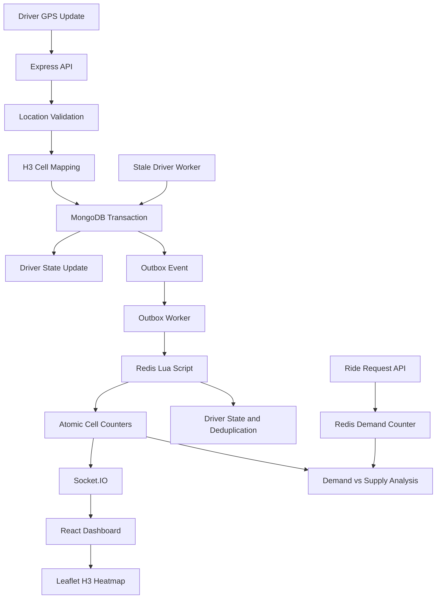

# GeoPulse – Real-Time Driver Availability & Demand Heatmap

GeoPulse is a real-time driver availability and geographic visualization system inspired by ride-hailing platforms.

It processes driver GPS updates, maps drivers into H3 hexagonal cells, maintains live availability counters in Redis, and broadcasts cell-level updates to a React dashboard using Socket.IO.

The backend also implements asynchronous event processing with MongoDB's Transactional Outbox pattern, atomic Redis operations, stale driver detection, and geospatial nearby-driver discovery.

## Key Features

- **Real-Time Driver Tracking:** Processes GPS updates and maintains driver location and availability.
- **H3 Geographic Indexing:** Converts latitude and longitude into H3 hexagonal cells (default resolution 9).
- **Redis-Based Availability Counters:** Maintains available-driver counts for each geographic cell.
- **Atomic Redis Operations:** Uses Lua scripting to update cell counters and driver state atomically.
- **Transactional Outbox:** Stores driver state changes and corresponding events within the same MongoDB transaction.
- **Duplicate and Outdated Event Protection:** Uses sequence numbers, state versions, event IDs, and SHA-256 fingerprints.
- **Background Event Processing:** Processes pending Outbox events asynchronously with retry and exponential backoff.
- **Stale Driver Detection:** Automatically marks drivers offline when their location updates become outdated.
- **Nearby Driver Discovery:** Uses MongoDB geospatial queries and a `2dsphere` index to find nearby available drivers.
- **Live Dashboard:** Uses Socket.IO to broadcast heatmap updates to a React frontend.
- **Demand vs Supply Analysis:** Compares recorded ride-request counts with available-driver counts across H3 cells.
- **Driver Simulator:** Simulates multiple drivers sending periodic GPS and availability updates.
- **Automated Testing and Load Testing:** Includes Jest, Supertest, and k6-based tests.

## Tech Stack

| Category | Technologies |
|---|---|
| Backend | Node.js, Express.js |
| Database | MongoDB Atlas, Mongoose |
| Live Data | Redis |
| Geospatial Indexing | H3, MongoDB 2dsphere |
| Real-Time Communication | Socket.IO |
| Frontend | React, Vite |
| Map Visualization | Leaflet, React Leaflet |
| Testing | Jest, Supertest |
| Load Testing | k6 |

## System Architecture



## How It Works

### 1. Driver Location Processing

Drivers send location updates containing:

- Driver ID
- Latitude and longitude
- Timestamp
- Sequence number
- Availability status

The backend validates the incoming data and converts the coordinates into an H3 cell.

### 2. MongoDB State Management

MongoDB stores persistent driver information, including:

- Current location (GeoJSON Point)
- Availability status
- H3 cell
- Last accepted sequence number
- State version
- Last location update time

A `2dsphere` index supports geospatial queries.

Sequence-number checks prevent older location updates from overwriting newer driver state.

### 3. Transactional Outbox Pattern

When a driver update is accepted, the backend updates the driver document and creates an Outbox event within the same MongoDB transaction.

This ensures that the database state change and its corresponding event are committed together.

Each event contains information such as:

- Event ID
- Driver ID
- Previous and new H3 cells
- Previous and new availability status
- Sequence number and state version
- Event fingerprint

### 4. Asynchronous Event Processing

A background worker continuously looks for pending Outbox events.

It atomically claims an event by changing its status from `pending` to `processing`.

The worker then applies the state transition to Redis.

If processing fails, the event is returned to `pending` with an increased retry count and an exponential backoff delay, capped at 30 seconds.

### 5. Atomic Redis Counter Updates

GeoPulse uses a Redis Lua script to perform multiple related operations atomically.

The script:

- Checks whether an event has already been processed.
- Validates the incoming state version.
- Reads the driver's previous Redis state.
- Removes the driver's previous availability contribution.
- Adds the new availability contribution.
- Updates the driver's Redis state.
- Marks the event as processed.

This prevents duplicate event processing from incorrectly changing availability counts.

### 6. Real-Time Dashboard Updates

After a successful Redis transition, the worker retrieves the updated counts for affected H3 cells and broadcasts them through Socket.IO.

The React dashboard applies these updates without requiring a complete page refresh.

### 7. Stale Driver Detection

A separate background worker periodically checks for drivers whose last location update is older than the configured threshold.

The current configuration uses:

- Stale threshold: 30 seconds
- Polling interval: 5 seconds

A stale driver is marked offline through a MongoDB transaction, and the corresponding Outbox event is created so that Redis availability can be updated asynchronously.

### 8. Nearby Driver Discovery

The nearby-driver endpoint uses MongoDB's `$geoNear` aggregation stage with a `2dsphere` index.

It filters for available drivers, calculates their distance from the requested coordinates, and returns up to 20 nearby drivers.

### 9. Demand vs Supply Analysis

Ride requests are mapped to H3 cells and recorded in Redis.

The analysis endpoint compares the demand count and available-driver count for each cell and classifies it as:

- `high-demand`
- `low-demand`
- `balanced`

The current demand implementation uses cumulative request counts. It does not yet track active rides or decrement demand after completion or cancellation.

## Project Structure

```text
GeoPulse/
│
├── frontend/
│   └── src/
│       ├── components/
│       │   └── HeatmapMap.jsx
│       ├── App.jsx
│       ├── App.css
│       └── main.jsx
│
├── load-tests/
│   ├── heatmap.load.js
│   └── location.load.js
│
├── scripts/
│   ├── inspect.redis.js
│   ├── simulate.drivers.js
│   └── watch.heatmap.js
│
├── src/
│   ├── config/
│   │   ├── database.js
│   │   └── redis.js
│   ├── controllers/
│   ├── middleware/
│   ├── models/
│   │   ├── Driver.js
│   │   └── OutboxEvent.js
│   ├── routes/
│   ├── services/
│   ├── socket/
│   ├── utils/
│   ├── workers/
│   │   ├── outbox.worker.js
│   │   └── staleDriver.worker.js
│   ├── app.js
│   └── server.js
│
├── tests/
│   ├── driver.service.test.js
│   ├── driver.validation.test.js
│   ├── outbox.integration.test.js
│   └── redisCounter.test.js
│
├── package.json
└── README.md
```

## Getting Started

### Prerequisites

- Node.js and npm
- MongoDB Atlas or another MongoDB replica-set deployment
- Redis instance
- k6 (for load testing)

MongoDB transactions require a replica-set deployment. MongoDB Atlas supports this.

### 1. Clone the Repository

```bash
git clone <your-repository-url>
cd GeoPulse
```

### 2. Install Backend Dependencies

```bash
npm install
```

### 3. Configure Backend Environment

Create a `.env` file in the project root:

```env
NODE_ENV=development
PORT=3000
MONGODB_URI=your_mongodb_connection_string
REDIS_URL=your_redis_connection_url
H3_RESOLUTION=9
CLIENT_URL=http://localhost:5173
```

Replace the connection strings with your own credentials.

### 4. Start the Backend

```bash
npm run dev
```

Backend URL:

```text
http://localhost:3000
```

### 5. Install Frontend Dependencies

Open another terminal:

```bash
cd frontend
npm install
```

Create `frontend/.env`:

```env
VITE_API_URL=http://localhost:3000
VITE_SOCKET_URL=http://localhost:3000
```

### 6. Start the Frontend

```bash
npm run dev
```

Vite typically starts the frontend at:

```text
http://localhost:5173
```

## API Documentation

| Method | Endpoint | Description |
|---|---|---|
| GET | `/` | Backend health check |
| POST | `/api/drivers/location` | Update driver location |
| GET | `/api/drivers/nearby` | Find nearby available drivers |
| GET | `/api/heatmap` | Retrieve current H3 availability data |
| POST | `/api/demand-supply/request` | Record a ride request |
| GET | `/api/demand-supply/analysis` | Retrieve demand vs supply analysis |

### Example: Driver Location Update

```http
POST /api/drivers/location
Content-Type: application/json
```

```json
{
  "driverId": "driver_101",
  "latitude": 28.4089,
  "longitude": 77.3178,
  "timestamp": "2026-11-05T10:30:00.000Z",
  "sequenceNumber": 1,
  "status": "available"
}
```

### Example: Nearby Driver Discovery

```http
GET /api/drivers/nearby?latitude=28.4089&longitude=77.3178&radius=3000
```

The radius is specified in meters. The endpoint returns up to 20 available drivers ordered by distance.

### Socket.IO Events

| Event | Direction | Purpose |
|---|---|---|
| `heatmap:subscribe` | Client → Server | Subscribe to heatmap updates |
| `heatmap:subscribed` | Server → Client | Subscription confirmation |
| `heatmap:cell:update` | Server → Client | Receive updated H3 cell availability |

## Driver Simulation

Run the built-in simulator:

```bash
node scripts/simulate.drivers.js
```

It simulates 10 drivers, sending GPS updates every 3 seconds with occasional availability changes.

Utility scripts:

```bash
node scripts/inspect.redis.js
node scripts/watch.heatmap.js
```

## Testing

Run the backend test suite:

```bash
npm test
```

The current project test suite contains 20 passing tests across 4 test files.

Coverage includes driver services, location validation, Outbox integration, and Redis counter operations.

## Load Testing with k6

Run the heatmap API benchmark:

```bash
k6 run load-tests/heatmap.load.js
```

Run the driver location API benchmark:

```bash
k6 run load-tests/location.load.js
```

### Benchmark Results

Measured using 10 and 25 virtual users over 30-second test runs.

| API | Virtual Users | Requests | Throughput | Avg. Latency | p95 Latency |
|---|---:|---:|---:|---:|---:|
| Heatmap GET | 10 | 280 | 8.99 req/s | 107.07 ms | 179.87 ms |
| Heatmap GET | 25 | 677 | 21.81 req/s | 132.51 ms | 232.83 ms |
| Location POST | 10 | 267 | 8.62 req/s | 147.07 ms | 210.07 ms |
| Location POST | 25 | 639 | 20.52 req/s | 194.58 ms | 374.01 ms |

**Benchmark observations:**

- All four clean benchmark runs recorded 0% HTTP failures.
- All configured k6 checks passed.
- The 25-VU heatmap test achieved approximately 21.81 requests per second.
- The 25-VU location update test achieved approximately 20.52 requests per second.

These are local benchmark results for the tested environment and workload, not production capacity guarantees.

## Important Design Limitations

The current implementation has a few known limitations:

- **No Outbox lease recovery yet:** Events are atomically claimed using `findOneAndUpdate`, but there is no lease expiration or automatic recovery of events left in `processing` after a worker crash.
- **Retry policy:** Failed processing attempts are retried with exponential backoff capped at 30 seconds. There is currently no maximum retry count or terminal failed-event handling.
- **Socket notification recovery:** Events are marked processed before Socket.IO notifications are emitted. A notification failure is logged, but the event is not retried for that notification.
- **Demand tracking:** Demand is cumulative and does not represent currently active ride requests.
- **Scale validation:** The current k6 results represent short local tests, not production-scale benchmarking.

## Future Improvements

- Implement lease-based Outbox event recovery and worker coordination.
- Add maximum retry attempts and dead-letter handling.
- Improve demand tracking using ride lifecycle events.
- Introduce Kafka for higher-volume event ingestion and independent consumers.
- Add authentication and role-based access control.
- Deploy with production monitoring and infrastructure.

## Project Status

GeoPulse is a backend-focused portfolio project demonstrating:

- Geospatial data processing
- Real-time event-driven architecture
- MongoDB transactions and the Outbox pattern
- Redis Lua scripting and atomic counters
- Background workers and retry mechanisms
- Real-time communication using Socket.IO
- Geospatial querying and API performance testing

**Built with Node.js, MongoDB, Redis, H3, Socket.IO, and React.**
